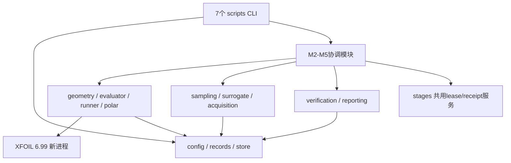
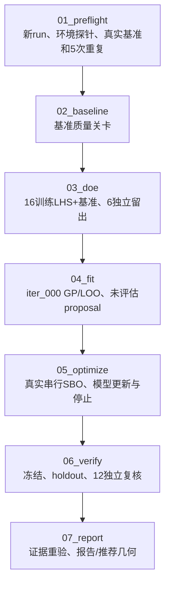
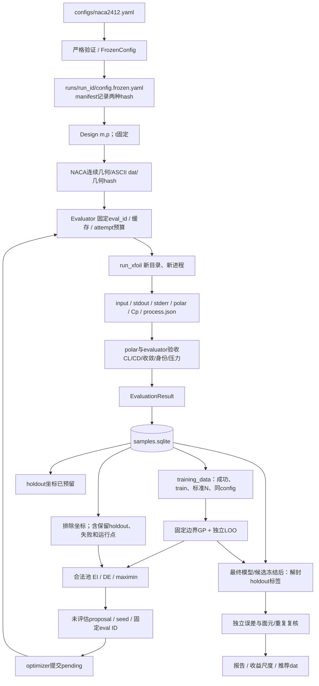
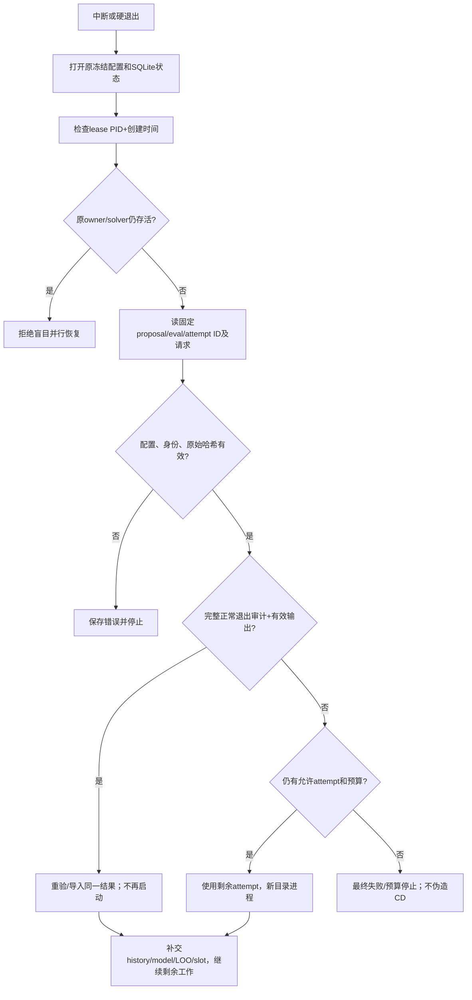

# 2 软件架构

本章回答“这些文件怎样合作，把参数变成最终推荐翼型”。你不需要先读完源码；可以先把整个程序看成四部分：管理实验、进行计算、决定下一次算什么，以及最后检查并出报告。以下说明依据当前代码（B）。源码范围是19个 `src/sbo/*.py`，入口为7个 `scripts/*.py`；静态函数/类/导入/参数证据见 [source_inventory.json](raw/source_inventory.json)。

## 2.1 四层软件架构

这里按主要工作把代码分成四层，目的是方便理解，并不表示各层只能按单一方向调用。`stages.py`横跨M2–M5；`config.py`会检查物理参数是否合法；M5会复用M4中检查训练数据的代码；报告模块也会复用拟合模块的 CSV 写出函数。不能把现有代码画成完全不相互引用的抽象框架。

| 层 | 当前文件 | 责任与边界 |
|---|---|---|
| 配置与实验状态 | `configs/naca2412.yaml`、config、records、store | 读取并检查 12 组、202 个配置项；保存本次实验的固定设置；记录计算结果、已用次数、当前阶段及模型版本 |
| 物理评估 | geometry、xfoil_runner、polar、evaluator、baseline | 把 m、p 变成翼型坐标，运行 XFOIL，检查输出是否有效；管理重试和缓存，并检查基准计算的数值质量 |
| SBO算法 | sampling、doe、surrogate、fitting、acquisition、optimizer | 选择初始样本，训练和检查预测模型，挑选新候选；逐个进行真实计算、更新模型，并判断何时停止 |
| 验证与报告 | verification、reporting | 先固定最终模型和候选，再用独立测试数据检查预测；执行 12 次复核，判断改善是否可靠，最后输出报告和几何 |
| 共享阶段服务 | stages、m2_cli | 防止同一实验被两个阶段同时改写，检查前一步是否完成，保存进度及文件校验记录；为 M2 两个入口提供共用命令行处理 |

### 进一步读代码：主要调用关系

- `Evaluator.evaluate()` → `generate_from_config()`、`XfoilSettings.from_config()`、store预约/启动记账、`run_xfoil()`、`parse_attempt()`和Cp检查；runner只执行一次attempt，不拥有自动重试。
- `run_fit()` → 验收M2初始17个训练ID → `prepare_training_data/fit_gp/loo_cv/save_model` → `propose`；完成后不向evaluation表提交该提议。
- `run_optimize()`先校验/必要时恢复M3，再取得M4独占lease；借 `_verified_data/_ensure_model`绑定当前成功训练证据与每轮模型。
- `run_verify()` → optimizer的 `_verified_data`、surrogate的 `load_model`、store最终留出接口、evaluator独立verification、baseline的 `pressure_diagnostics`。
- `run_report()`局部导入verification的 `_context/_holdout/verification_summary`，重新核验证据；verification在写产物时局部导入reporting。这个双向引用使用函数内导入避免顶层循环初始化，不代表纯四层单向依赖。

## 2.2 CLI / Script 入口层

`scripts/` 中的脚本是命令行入口（CLI）：读取你输入的参数，安排对应阶段的工作。具体算法和大部分计算逻辑位于 `src/sbo/`。实际例外是01的环境探针、Conda锁导出和M1预检循环也直接实现于脚本。02/03共用`m2_cli.main(stage,PROJECT)`；04–07各有小型argparse main。没有已安装的统一 `sbo` console command，也没有Web服务入口。

通常前置关系如图；07可在未完成实验上写诊断报告，不能因文件生成而标整体完成。01只能新建run；02–06支持显式resume；07无resume参数。

## 2.3 核心运行数据流

跟着一个新设计看就容易理解：先给出 m、p，几何模块生成坐标，评估器让 XFOIL 计算，再把检查合格的 CD 存进数据库。代理模型从这些数据学习；选点模块给出下一组 m、p，于是再走一遍。独立测试点和最终复核结果另行保存，不混进训练集。

**只有直接成功验收结果可成为训练标签。** GP均值、σ、EI、proposal、失败罚值都不是直接求解数据。`EvaluationResult.usable_for_training`要求success、train、purpose属于baseline/doe/sequential、标准panel count及非空气动值；store查询进一步限制同config。holdout和verification即使success，也不能通过该训练筛选。

三个编号各有用途：`design_id`识别翼型形状，用完整 `m,p,t` 的精确浮点表示（float.hex）计算指纹；`eval_id`识别一次评估任务；`attempt_id`识别这次任务中的一次 XFOIL 启动。一次重试仍是同一个design/evaluation；独立复核需新evaluation。模型编号按成功序贯数推进，proposal轮次按尝试过的设计结果推进，两个计数不必相同。

## 2.4 状态与文件持久化

“持久化”就是把进度和结果存到磁盘，让程序退出后仍能继续。SQLite 是本项目的本地数据库，可理解为实验账本：哪一个点算过、结果是否有效、还剩多少预算，以它的记录为准。CSV 便于用表格查看，JSON 便于程序交换信息；它们通常是账本的导出或摘要。XFOIL 的原始输出也必须保留，因为只看摘要无法重新核验计算。

以下术语主要用于理解中断恢复：

| 术语 | 通俗解释 |
|---|---|
| manifest | 本次实验的总说明，记下配置、环境、阶段和文件身份 |
| checkpoint | 进度快照，告诉你上次做到哪里；它反映数据库中已经保存的状态 |
| receipt | 一组产物的校验记录，用文件指纹确认内容没有被替换 |
| lease | 当前哪个进程有权推进本实验的占用记录，防止两个进程同时修改 |
| registry | 登记表；model registry 记录每个模型版本使用了哪些数据和文件 |
| slot / pending | slot 是计划中的一项计算任务；pending 表示已登记、尚待完成的任务 |

主实验根目录是 `runs/m1_20261013_02/`。核心职责如下：

| 对象 | 权威状态/角色 | 不能替代什么 |
|---|---|---|
| config.frozen.yaml + manifest中的hash | 实验输入及配置身份；默认配置后续修改不影响旧run | 不可用新默认配置解释旧标签 |
| SQLite metadata/designs/evaluations/attempts | 配置/预算上限、固定split/坐标、请求与结果、启动事实 | stdout有结果不等于数据库已提交/已验收 |
| SQLite events | 预约、启动、review、模型/提议、解封等审计事件 | 用户回复与自动accept不能混为同一种审批 |
| SQLite stages | baseline/doe/fit/optimize/verify/report状态、RNG、pending、已完成LOO折、终止快照 | checkpoint.json不是独立恢复事实源 |
| SQLite models | 9个模型的元数据、训练ID/data hash和joblib身份 | 单独joblib文件不能自证版本/数据来源 |
| SQLite run_lease | 同run唯一stage owner的token、PID、创建时间 | 单纯PID不足以识别进程身份 |
| evaluations/eval_id/attempt_n | 几何、会话、原始输出、process/attempt/result审计 | 原始文件受损不能靠重建GP消除证据问题 |
| checkpoint.json | DB已提交状态的原子投影，可重写/重建 | 不手工重置预算或回填新结果 |
| samples/holdout/failures CSV、datasets.json | split独立的导出快照/哈希；失败CD空 | CSV不是全部有效训练标签的授权名单 |
| models/iter_k | GP二进制、元数据、training快照、逐折LOO、初始proposal | model id、data hash、config hash必须相符 |
| proposals/iter_k.json | DB pending的文件投影，含seed/model/eval绑定 | 若文件丢失以DB恢复，不偷偷再选同一轮坐标 |
| optimization/history/best-so-far | 标准精度序贯历史与停止时报告；39次预算快照 | 不追记M5的12次费用，不认证收益 |
| verification与holdout-predictions | 冻结后独立验证/复核的明细与结论 | 不回流训练，不把标准160和240交叉比较 |
| report及reports/、best_airfoil | 核验证据后的报告、镜像表图、几何/来源hash | 导出文件存在不自动证明质量通过 |

SQLite不是一切文件内容的替身：raw polar/stdout/Cp/geometry本身仍须通过哈希、解析及配置/求解器身份复核；冻结配置与manifest也直接被读取。数据库是结果、预算和阶段恢复状态的事实源，其他文件各自保留原始证据或派生视图。

账本版本仍叫`m2-ledger-v2`，不表示只能执行M2。预检pass存于manifest/preflight，主实验SQLite没有preflight stage行；实际有6个stage、9个models、51个evaluations、51个attempts、31个designs、476个events、0个lease。预算上限字段是配置值，`reserved_final_verification_launches=12`不是“当前仍有12次未使用”。

holdout没有加密/文件权限封锁：M2求解、SQLite/CSV导出已读取并保存结果；M3/M4业务路径只消费坐标、不消费标签。`final_holdout_data()`是M5的受控接口，但普通内部store/get_result接口不是完整访问控制边界。

## 2.5 恢复机制

恢复的关键不是简单地“再运行一遍”。程序要先判断：上一次到底没开始、算到一半，还是已经算完但来不及登记？如果输出完整且能核实，就接收原结果；如果确实没有完成，才在剩余重试次数和预算内继续。这样可以避免同一点被无意重复计算，或把来历不明的文件当成有效结果。

- 02/03/04/05/06显式`--resume`；01不覆写实验；07按当前证据重新导出，没有`--resume`。
- 评估恢复保持同eval ID、request、physics、几何及剩余attempt；正常process审计有结果但DB尚未提交时优先导入。旧请求缺恢复元数据、PID身份缺失或原结果哈希改变时停。
- DOE恢复固定槽位、RNG/排除坐标；M3恢复逐折LOO及proposal；M4恢复pending/history和model progress；M5恢复固定独立slot，不能复用一个N200结果充当两次重复。
- M3/M4冻结前可从核实的数据重建损坏派生模型并归档旧文件；M5解封后最终GP必须保持冻结，不能再次refit。原始solver证据受损时所有阶段都不能用派生重建来掩盖问题。
- `needs_review`必须停机；明确decision/reason事件后续跑。没有用户结论不能自动把异常数值变成训练或认证依据。

## 2.6 文档与代码的边界核对

| 已发现差异/容易误读处 | 当前事实 | 归档处理 |
|---|---|---|
| README“并预留models表” | M3/M4已实际注册9个模型，不是仅预留 | 按实际models registry写 |
| 07被称“只读证据报告入口” | 零XFOIL/零fit，但会写stage、checkpoint、manifest、报告/几何；会局部更新verify receipt | “只读”限定为不改物理标签/模型，不把它当纯文件读取命令；本次未运行07 |
| “后续完成阶段重跑只核验/复用” | 没有新solver不等于零写入；02/03仍导出CSV/checkpoint；03核验已有holdout结果 | 归档采用底层只读读取，不用重跑CLI证明事实 |
| 配置fallback_on含duplicate_proposal | acquisition没有同名reason赋值分支；距离排重和DE无效候选丢弃保护重复，通常保留合法池赢家 | 不写成“每个非法DE结果都自动maximin” |
| 05流程图“下一候选→停止” | 每轮先检查硬停止；若尚未停才生成下一proposal以取得合法池EI，再检查收敛 | 03/04章写两次停止判断 |
| 数据sealed | M2已经保存标签，M3/M4不使用；不是密码学封存 | 不声称所有代码在M5前都不能读取任何标签 |
| 当前/历史stage报告的后续阶段“尚未执行” | preflight/doe.md等保留当时范围；当前顶层README已M1–M5 | 历史快照与当前状态区分，不判为全部报告过时 |

这些差异没有改变已记录的主实验CD、GP训练数据、51次预算或最终收益结论。本次只记录差异，没有修正现有源码、配置或README。
