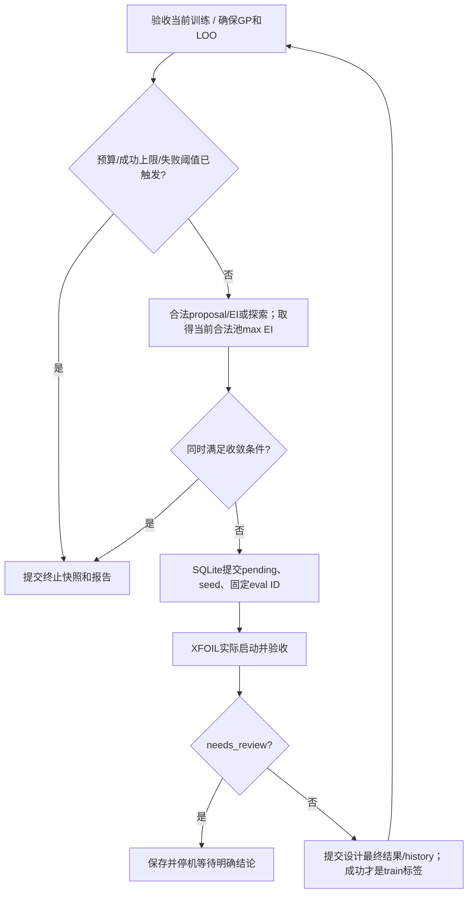

# 3 实际执行流程

本章是一份实际操作手册：从准备环境开始，按顺序运行七个脚本，并说明每一步应该看到什么。操作说明依据当前代码（B）；写有“历史结果”的数字是已有实验的结果（A），不保证另一次运行逐字复现所有输出。命令是操作说明，不代表本次归档执行过它们。本次没有运行项目入口、pytest或XFOIL。主实验 `m1_20261013_02`已经完成，01不能覆盖该run；新实验必须用未使用的合法run-id。

## 阅读和操作约定

- 所有命令都在项目根目录 `D:\codex\sbo` 的 PowerShell 中运行，并使用 `sbo-xfoil` 环境。
- 先运行 01 创建实验，再让 02–07 使用同一个 `run-id`。它相当于实验编号，决定结果保存在哪个 `runs/<run_id>/` 目录。
- 命令中的 `<new_run_id>` 和 `<run_id>` 是占位符，执行前必须换成自己的实验编号，不能连同尖括号一起输入。
- 程序的“退出码”是结束状态：0 通常表示该入口成功完成，非 0 表示失败、未完成或需要处理。还应查看对应报告，不能只看终端有没有输出。
- 本章展示真实可用的命令，但本次文字整理没有执行这些命令。需要恢复中断任务时，先读 3.10，避免误建新实验。

| 顺序 | 这一阶段要回答什么 | 首次正常执行会新增气动计算吗？ |
|---|---|---|
| 01 预检 | 环境和基准计算能否正常工作？ | 会 |
| 02 基准检查 | 改变面元数量、重复计算后，基准是否稳定？ | 会 |
| 03 初始采样 | 用哪些真实结果开始训练，并留哪些点做最后测试？ | 会 |
| 04 初次拟合 | 目前的模型预测得怎样，下一点值得算哪里？ | 不会 |
| 05 序贯优化 | 不断加入新计算后，能否找到更低阻力的设计？ | 会 |
| 06 最终验证 | 模型和改进方案能否通过独立检查？ | 会 |
| 07 报告导出 | 最终结论是什么，推荐翼型文件在哪里？ | 不会，但会写报告和阶段状态 |

## 3.1 环境安装

Conda 用来管理 Python 及其依赖版本。BLAS 是 NumPy 等库底层执行矩阵运算的组件；本项目明确采用 OpenBLAS，因为开发时曾遇到另一种构建的原生调用故障。XFOIL 则是单独的可执行程序，不会随着安装 Python 包自动出现。

来源：[`environment.yml`](../../environment.yml)、[`environment-win-64.lock.txt`](../../environment-win-64.lock.txt)、[`pyproject.toml`](../../pyproject.toml)、主实验 `environment.json` 与导出的构建锁。

| 项目 | 真实声明/主实验 |
|---|---|
| 环境名/渠道 | `sbo-xfoil`；conda-forge |
| Python | yml为3.11，pyproject为`>=3.11,<3.12`；实际锁/预检3.11.17 |
| NumPy / SciPy / sklearn | 1.26.4 / 1.14.1 / 1.5.2 |
| pandas / matplotlib | 2.2.3 / 3.9.2 |
| PyYAML / joblib / psutil | 6.0.2 / 1.4.2 / 6.0.0 |
| pytest / setuptools / pip | 8.3.3 / 75.1.0 / 24.2 |
| BLAS | 显式OpenBLAS；libblas/libcblas/liblapack使用openblas构建；实际libopenblas .3.34 |
| 本机Python | `D:\Program_Files\miniforge3\envs\sbo-xfoil\python.exe` |
| XFOIL | 6.99；`D:\codex\sbo\tools\xfoil\xfoil.exe`；exe SHA256=`c17342f84ae260c2b11a74cd0e2fb8189a5f8954c6bb7a8467a0f27055c7faea` |

新环境按当前声明建立：

```powershell
Set-Location D:\codex\sbo
conda env create -f environment.yml
conda activate sbo-xfoil
```

严格重建已验收的Windows构建时使用实际explicit锁，而不是重新解算最新版：

```powershell
conda create --name sbo-xfoil --file environment-win-64.lock.txt
conda activate sbo-xfoil
```

以上是两条环境建立路径，不能在同一个已存在的同名环境上连续当作安装步骤。锁文件是win-64，不是跨平台通用依赖清单。环境已经存在且正确时不重复创建。

XFOIL不是Python依赖，也没有项目内自动下载入口。当前本地 `tools/XFOIL6.99.zip`、`tools/xfoil/`和源码包已存在，目录被Git忽略；干净Git checkout不能假定有exe。依据已有来源和配置，将合法取得的6.99可执行文件放到声明位置；迁移路径要在新实验创建前修改默认配置的绝对路径，不能改旧run的冻结YAML。UIUC参考已跟踪于 `data/reference/`，M2需要它及来源哈希。当前路径与构建状态仅用保存的文件核对，未在归档中安装环境或测试新平台。

## 3.2 安装当前项目

这一步把当前源码目录注册为 Python 包。“可编辑安装”意味着之后修改源码，不需要每次重新打包安装。它只解决 Python 能找到项目代码的问题；XFOIL 能否正确计算，还要由下一步检查。

项目根目录、激活上述环境后，README的真实安装命令为：

```powershell
conda activate sbo-xfoil
python -m pip install --no-deps --no-build-isolation -e .
```

`--no-deps`依赖已按声明安装；`--no-build-isolation`使用当前setuptools；pyproject通过 `src`发现sbo包。历史命令输出确认editable安装完成，M1/M3随后能导入。成功安装不证明XFOIL有效，必须另经01预检。七个scripts也插入项目src到sys.path，支持源码checkout调用；没有统一console script。

## 3.3 M1 预检

先证明“这台机器能把一个翼型可靠地算完”。预检通过后才有必要采集更多数据，否则后面会把同一个环境错误重复很多次。

```powershell
python scripts/01_preflight.py --config configs/naca2412.yaml --run-id <new_run_id>
```

`<new_run_id>`为需要替换的文档占位符，实际值必须是1–64个ASCII字母/数字/下划线/连字符，首字符为字母或数字，不得是Windows设备名；不存在同名run。历史成功使用 `m1_20261013_02`，失败环境诊断使用 `_01`。不要复制该成功名字来覆写现有实验。

**输入**：默认YAML或`--config`指定文件、新run-id、真实exe及环境。

**内部顺序**：严格检查 202 个具体配置项→建立新run与冻结YAML/manifest→在有时间限制的子进程中检查包版本、BLAS 构建，并用人为数据试运行 GP→求解真实基准，保存Cp→5次独立verification调用→验证基准缓存复用不增加预算→导出该Conda环境explicit锁。

**产物**： `config.frozen.yaml`、`manifest.json`、`environment.json`、probe/export日志、`environment-win-64.lock.txt`、`preflight.json/md`、SQLite及evaluations。合成GP只检查依赖，不写入气动账本，不是M3初始surrogate。

**成功判据**：程序返回0，`preflight_passed=true`、目标点/5次调用/进程清理/缓存预算检查通过，环境锁成功导出。

**历史结果**：CL=.5、CD=.00599、6次启动、1个标准设计；五次中位约.281s。

**失败**：配置/路径/重复run-id在开始前返回2；环境、气动或运行中异常保留failed报告，当前main通常返回1。默认README概括为非0，不要把所有01错误都写成2。MKL探针、Windows权限、缺失exe/不匹配版本或目标点失败都会阻止M1通过。隐藏`--dependency-probe`是内部子进程参数，会写environment.json并做合成GP，不是供归档/用户替代完整预检的入口。

## 3.4 M2 Baseline

这一步检查作为对照组的 NACA 2412 是否算得稳定。面元是表面上的离散小段；如果稍微改变面元数量就让 CD 大幅变化，后面很小的阻力改善便不值得相信。

```powershell
python scripts/02_baseline.py --run-id <run_id>
```

**输入**：已有且M1通过的run，读取它的冻结配置。

**调用**：02→`m2_cli.main('baseline',PROJECT)`→`run_baseline`。

**内部**：复用M1已验收160+Cp基准，新评估200、240、重复160；解析目标CL，比较UIUC参考几何、压力和转捩位置。这里repeat是160，与M5的repeat200不同。

**门槛**：全部有效目标点；几何对照max y差≤`.0002c`；Cp三列有限、转捩在[0,1]、Cp范围[-20,2]、尾缘两侧Cp差≤.15；重复CD差≤`1e-5`；200/240差≤`max(2e-5,.01×CD240)`。

**产物/成功**： `baseline.json/md/png`、新增独立evaluation及DB阶段receipt；0表示关卡通过，异常/不完整返回2。实际CD `.00599/.00599/.00600/.00599`，200/240差`1e-5`，重复差0，累计9启动。

## 3.5 M2 DOE

DOE 是初始试验设计。程序安排 16 个新训练点，加上已有基准共 17 个；另外安排 6 个独立测试点。后者的答案此时已经计算和保存，但之后训练、选点都不会使用它们。

```powershell
python scripts/03_doe.py --run-id <run_id>
```

**输入**：M1/M2 baseline已通过且完整证据仍有效。

**内部**：预留全部train/holdout坐标及split→基准加入排除集合→seed42生成16训练LHS、seed2026生成6留出LHS→先完成train槽位，再完成holdout→按固定eval ID求解和持久化。

一个设计用完允许的重试后仍失败，程序会保留该坐标及失败记录，但不给它编造 CD。随后从 4096 个随机候选中，选离已占用位置尽可能远的新点补上；随机数生成器（RNG）的状态也会保存，以便中断后接着采样。替补使该split的`strict_lhs=false`。启动/清理/身份错误或预算上限会停止，而不是无限替补。异常点需显式review。

**产物**： `doe-plan.json`、`doe.json/md/png`、`samples.csv`、`holdout.csv`、`failures.csv`、`datasets.json`、`checkpoint.json`及账本。训练17=16+基准，holdout6单独导出；M3/M4不读留出标签。

**实际结果**：无失败/替补，累计31启动、23不同标准设计。成功返回0，数量不足/异常/中断非0。

## 3.6 M3 GP 拟合

把已有的 17 组“形状参数—阻力”交给 GP 学习。LOO 会轮流暂时拿出一个点，检查模型能否用其余点预测它。最后输出下一点的建议；这时还没有该候选的真实阻力值。

```powershell
python scripts/04_fit.py --run-id <run_id>
```

**输入**：M2完成、初始基准+DOE的17个成功标准train ID。

**内部**：重新验收原始数据和完整坐标/设计hash→固定边界归一化→GP拟合/注册→逐折独立LOO并持久化→合法Sobol/边界池及DE→未评估proposal。

GP使用Constant×ARD Matérn5/2，normalize_y，alpha从`1e-6`开始、只在Cholesky失败时按`1e-5,1e-4`回退，seed43，5次重启。LOO MAE超门槛只记录下一轮探索，不自动认定流程失败。

**产物**： `fit.json/md`；`models/iter_000/gp.joblib,metadata.json,training.json/csv,loo.json/csv/png,proposal.json`；DB model/stage。

**成功/结果**：0；17折MAE=`9.81823e-5≤.0002995`；首候选`.02968781837316655/.46704290397180875`、预测CD≈`.00549696`。

**XFOIL新启动0**，proposal不是evaluation；主实验仍31次。模型派生损坏可resume重建，原始数据受损拒绝。

## 3.7 M4 SBO 优化

这是项目最主要的优化步骤。每轮先提出一个候选，用 XFOIL 求得真实结果，再决定是否加入训练集。新数据改变了模型，也就改变了下一次选点的依据。

```powershell
python scripts/05_optimize.py --run-id <run_id>
```

主SBO入口为05→`optimizer.run_optimize()`。其真实循环带有前置/后置停止检查：



首次仍合法时复用M3坐标；之后按尝试轮次生成新的seed/proposal。成功增加训练和成功计数、拟合下一个 `iter_k`；失败坐标排除但不增成功数，数据未变时复用模型。第4、第8等成功新点以及LOO超限触发maximin探索；后续点数达到停止条件时不再启动。

最多12成功新增；35计划有效标准设计、45不同标准设计、120总启动，正常评估保护12最终复核预留。连续3个最终失败、完整最近10点失败率>.2或系统错误非正常终止。收敛必须成功≥8、`B[n−5]−B[n]≤2e-5`、有效合法池maxEI<`1e-5`同时满足；无效EI不作0。

**产物**： `optimization.json/md`、`history.csv`、`best-so-far.png`、`proposals/iter_001..008.json`及 `models/iter_001..008/`；DB pending、history、model progress和终止快照。

**实际结果**：8成功/0失败，25训练，`iter_008`，改善窗口0、maxEI=`2.511076969259259e-6`，正常converged，累计39启动。05返回0只在已有真实成功更新且合法正常停止；`stopped`及异常返回2。标准最佳CD=.00544尚不能代替M5认证。

## 3.8 M5 独立验证

这里做两种不同的检查：一是用 6 个预留点检查模型能否预测没参与训练的数据；二是重新计算基准和候选，检查阻力改善是否经得起更细面元和重复计算。两者不能互相代替。

```powershell
python scripts/06_verify.py --run-id <run_id>
```

最终验证入口06→`verification.run_verify()`，要求M4正常完成、冻结证据一致、无无关unfinished评估、足够完成三翼型×四槽位的启动预算。第一次进入本阶段时，程序固定最终 GP、训练数据及编号、两个按标准 CD 选出的非基准候选，以及留出点坐标。先登记 12 项独立复核任务，再记录“开始使用留出答案”的事件，随后计算模型误差。

每个翼型独立N160、200、240、另一次200；`purpose='verification',save_cp=True,bypass_cache=True,use_reserved_budget=True`。即使旧标准点/旧baseline复核存在也重新计算；explicit resume才复用本槽位。每次retry另计启动，总预算仍120。确认Cp、转捩、目标CL、200/240差和200重复差，计算ε并比较同精度CD240。slot重复ID/面元结构不一致、冻结前结果、原始证据损坏等不能获得认证。

**产物**： `verification.json/csv/png`、`holdout-predictions.csv`、DB freeze/hash/slots/holdout及完成快照；各独立会话/pressure原始证据。所有质量门槛通过返回0，holdout超限或任何翼型质量失败返回2并保留分项结论；缺预算/异常/needs_review也非0。

**实际结果**：6点holdout MAE=`5.12602e-5≤.0002995`；12次独立复核全部通过，基准CD240=.00600、候选1=.00545、候选2=.00546，推荐候选1；累计51启动。质量通过不要求一定有收益：无合格候选能改善超过ε之和时，流程可完成并推荐基准。基准复核失败时没有推荐；其他候选失败不认证该候选。

## 3.9 报告导出

这一步把已经完成的计算整理成可阅读的报告，并导出推荐翼型的坐标。它会再次核对结果来源，所以不是把几个表格简单拼起来；证据不完整时，报告会明确说明，不能假装有合格推荐。

```powershell
python scripts/07_report.py --run-id <run_id>
```

07→`reporting.run_report()`，不调用XFOIL、不fit GP，但会加载并验证最终模型/源证据、核对holdout预测、构建图表，并写stage/checkpoint/manifest及报告。这不是适用于本次归档的“零写入检查”命令，所以本次没有执行。

| 真实位置 | 内容 |
|---|---|
| run根目录 `report.md/json/png` | 最终综合报告、质量/失败统计和推荐信息 |
| run根目录 `verification.json/csv/png` | 12槽位明细、面元/重复差、epsilon与认证 |
| `holdout-predictions.csv` | 6点观测、均值、σ、残差 |
| `best_airfoil.dat/json` | 321点推荐几何及完整参数、geometry/config/freeze hash、来源eval IDs、边界命中、推荐原因 |
| `reports/summary.md,metrics.json,final_comparison.csv` | 约定报告目录；metrics是report JSON镜像，final_comparison是verification CSV镜像 |
| `reports/best_airfoil.dat/json` | 推荐几何/元数据镜像；可能是基准而非候选 |
| `reports/figures/report.png,verification.png` | 几何、Cp、采样、best-so-far、holdout及panel图 |
| `report-recovery/` | 替换的损坏派生产物或撤回的旧推荐归档 |

质量失败仍生成报告，返回2；未完成M5或源证据损坏只写`incomplete`诊断并撤回活动推荐。未读到完整前置资料时还可能由CLI返回异常非0；“缺阶段可诊断”不意味着缺exe/冻结配置也可以无条件成功。不同run的报告不会自动拼成一个大数据集。

## 3.10 Resume、停止边界与显式复查

如果程序中途停止，先区分是“有意暂停”“需要人工判断”还是“文件或运行出错”。`--resume` 会沿用原实验的编号、配置和计算记录继续工作，不会自动清空错误或重置预算。下面的停止参数主要用于验证恢复能力，普通完整运行不需要填写。

从真实argparse确认，不按泛化CLI补造参数：

| 入口 | --resume | --stop-after | --stop-after-folds | --stop-after-evaluations | 三个--review参数 |
|---|---|---|---|---|---|
| 01_preflight | 无 | 无 | 无 | 无 | 无 |
| 02_baseline | 有 | 无 | 无 | 无 | 有，来自m2_cli |
| 03_doe | 有 | 有 | 无 | 无 | 有，来自m2_cli |
| 04_fit | 有 | 无 | 有 | 无 | 无 |
| 05_optimize | 有 | 无 | 无 | 有 | 有，只准当前pending eval |
| 06_verify | 有 | 无 | 无 | 有 | 有，只准本stage needs_review slot |
| 07_report | 无 | 无 | 无 | 无 | 无 |

02/03的共享review CLI调用通用 `Evaluator.review()`，没有05/06那种额外“当前pending slot”筛选，通用评估器仍要求该eval属于needs_review并给出理由。不能把两者写成完全同一限制。

所有review命令必须同时提供`--resume`、eval ID、decision和非空reason，decision只允许accept/reject。真实参数形式为：

```powershell
python scripts/03_doe.py --run-id <run_id> --resume --stop-after 4
python scripts/04_fit.py --run-id <run_id> --resume --stop-after-folds 3
python scripts/05_optimize.py --run-id <run_id> --resume --stop-after-evaluations 1
python scripts/06_verify.py --run-id <run_id> --resume --stop-after-evaluations 4
python scripts/06_verify.py --run-id <run_id> --resume --review-eval-id <eval_id> --review-decision reject --review-reason "已核对原始结果并排除该异常点"
```

停止选项是恢复诊断，不是气动收敛判据：03按本次新设计结果数；04按本次新完成LOO折；05按本次结果和必要模型更新；06按本次处理的未完成槽位。它们保留现场、故意返回非0，再以不带停止上限的resume继续；不要在本次归档或已完成主实验中为展示而执行。阶段早已完成时不会重新制造同样数量的新评估。

**已保存的主实验恢复（A）**：03四点→续跑；04前三折→剩余十四折（期间纠错）；05首点/model1→剩余七次；06前四个基准复核→剩余八次。原始shell封装的exitCode有时为1，而Python subprocess日志明确保存的06边界退出码为2；两种字段不可混用。继承账本的硬退出测试另有退出74/75等故意中断值，不是CLI正常成功值。

## 3.11 测试

单元测试检查某个函数或规则是否正确；集成测试检查多个模块以及真实程序能否一起工作。本项目部分集成测试会启动真实 XFOIL，所以它们不是免费的只读检查。

pyproject设定 `testpaths=['tests']`、`pythonpath=['src']`，注册integration标记；conftest补充同一标记。README标准命令：

```powershell
python -m pytest -m "not integration"
python -m pytest -m integration
```

本机已执行的回归采用关闭cacheprovider并留JUnit证据的形式：

```powershell
python -m pytest -q -p no:cacheprovider --junitxml=runs/m1_20261013_02/m5-tests.xml
python -m pytest tests/test_verification.py tests/test_verification_integration.py -q -p no:cacheprovider --junitxml=runs/m1_20261013_02/m5-final-tests.xml
python -m pytest tests/test_optimizer.py -k 'm5_final_model_damage or completed_model_damage_rebuilds or completed_stage_keeps_budget' -q -p no:cacheprovider --junitxml=runs/m1_20261013_02/m5-freeze-tests.xml
python -m pytest tests/test_verification.py::test_holdout_opens_only_after_committed_model_candidate_freeze tests/test_verification_integration.py -q -p no:cacheprovider --junitxml=runs/m1_20261013_02/m5-slot-tests.xml
```

以上是历史命令的核心调用，原日志使用本机环境Python绝对路径。全套299项曾有7项M5序列化失败；纠正后17项M5、3项冻结/旧行为、2项槽位/真实恢复复测通过；按测试身份合并最终300项（288单元、12integration）。有14项上游matplotlib/pyparsing弃用警告，不等于项目测试失败；不用抹掉原失败XML来宣称一次全绿。

integration不保证都启动求解器：runner/evaluator/hard-exit/M4/M5测试会真实使用exe；M3 real-data integration只读既有气动数据、生成派生模型而零新solver。缺exe/既有源实验时部分用例明确skip；skip不是部署或数值验收通过。单元测试会在隔离目录使用合成函数或修改过的真实fixture；不能把这些CD加入主实验。测试也会生成独立验证目录，复制账本测试继承历史预算，不能算作同一个全新数据集。

本次归档仅解析现有源码、XML/JSON和日志，没有运行上述测试。完整运行顺序是01→02→03→04→05→06→07；算法主入口05，最终验证06，最终报告07。
